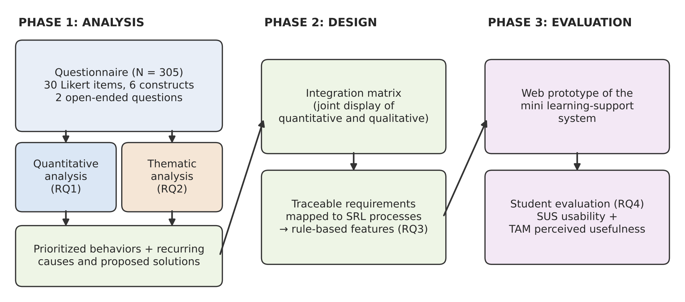
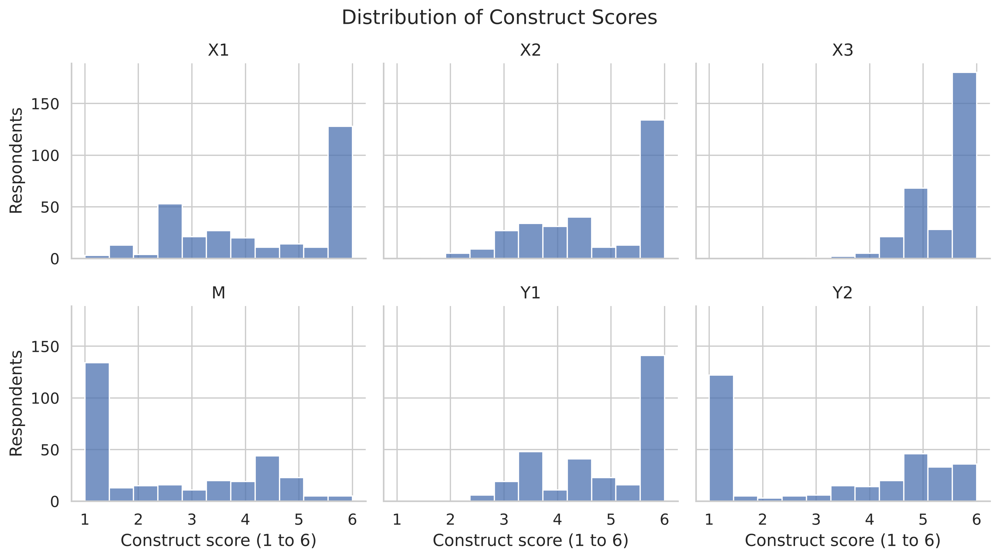
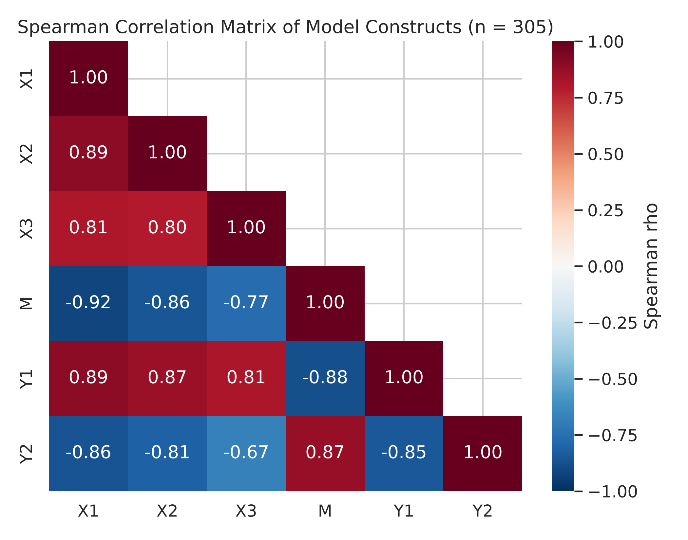
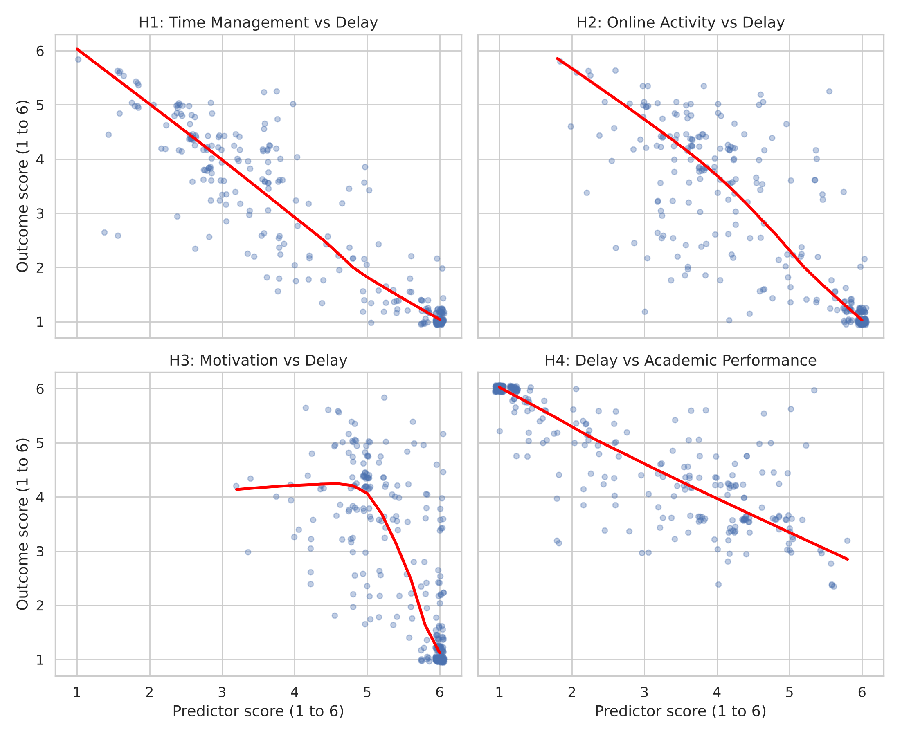
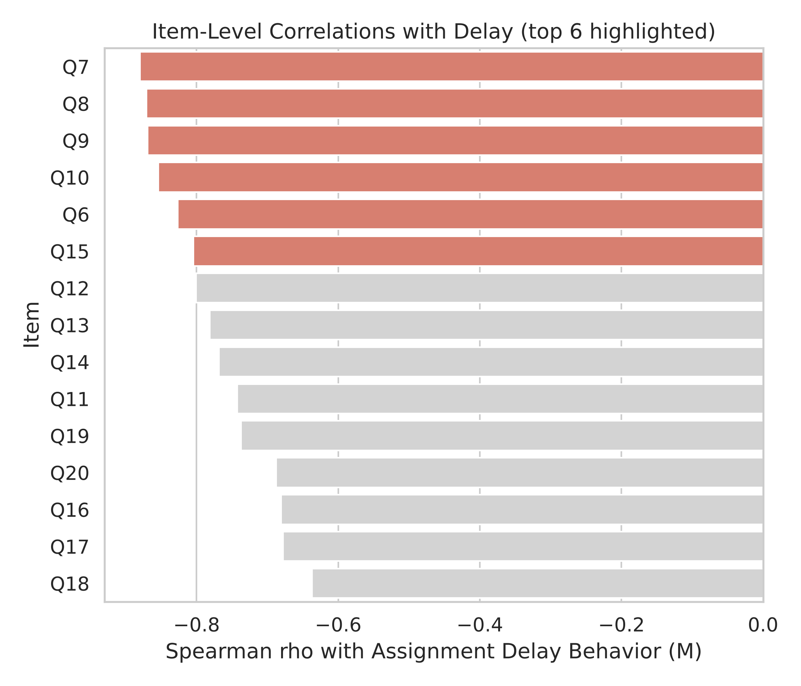
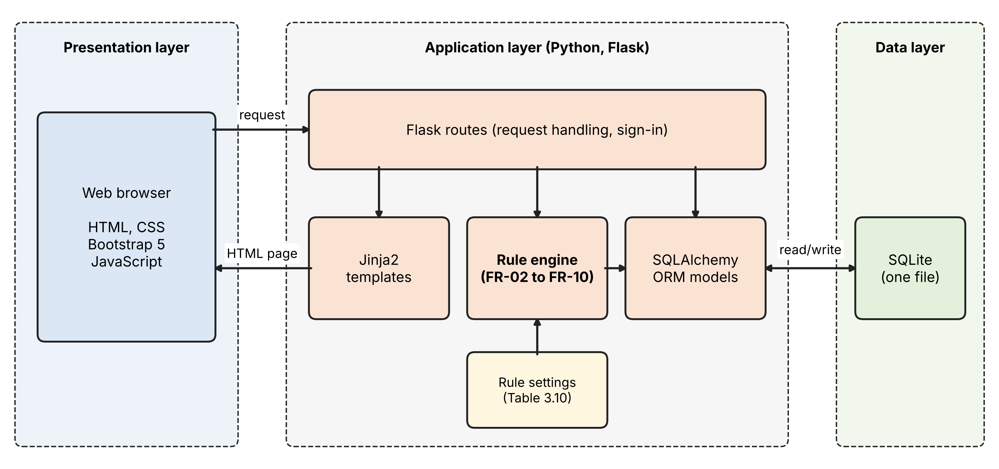

# Chapter 3: Research Methodology, Analysis, and System Design

This chapter describes how the study answers its research questions and reports the results of the analysis and design phases. It sets out the research design, the sample, the instrument, and the screening of the data, then reports the quantitative analysis (RQ1) and the thematic analysis (RQ2). It closes with the integration of the two strands and the resulting system requirements (RQ3), followed by the plan for evaluating the prototype (RQ4). The implementation of the prototype is reported in Chapter 4.

## 3.1 Research Design

The study combines a convergent mixed-methods design with design science research. In a convergent design, quantitative and qualitative data are collected together, analyzed separately, and then merged so that each strand can confirm, extend, or qualify the other (Creswell & Plano Clark, 2018). Design science research builds an artifact to address an identified problem and evaluates it against the needs it was built to meet (Hevner et al., 2004). Here, both strands come from one questionnaire, their merged findings serve as the design requirements, and the artifact is a mini learning-support system.

The study proceeds in three phases (Figure 3.1). In the analysis phase, the Likert items are analyzed statistically to identify the learning behaviors most strongly associated with self-reported delay and self-assessed performance (RQ1), and the open-ended responses are analyzed thematically to identify recurring causes of delay and proposed solutions (RQ2). In the design phase, the two sets of findings are merged in an integration matrix and translated into traceable system requirements (RQ3). In the evaluation phase, students will use the prototype and rate its usability and perceived usefulness (RQ4). Statistical analysis is used only in the analysis phase; the system applies fixed rules and runs no predictive model.

**Figure 3.1. Research Framework**

## 3.2 Population, Sample, and Sampling Technique

The target population is undergraduate students in Indonesian higher education institutions whose courses are delivered or supported through a learning management system. A non-probability convenience sample was used. The questionnaire was distributed as an online form between May and July 2026 through lecturers at each participating university, who shared the link with their students. Participation was voluntary, all respondents gave consent before answering, and each was assigned an anonymous identifier.

The form received 308 responses. Three respondents reported an age below 18 (14, 16, and 17 years) and were removed because the study is limited to adult participants, leaving 305 respondents for all analyses. Table 3.1 summarizes the sample. Most respondents were early in their studies (80.0% in their second semester), and 70.8% were enrolled in computing, data science, or information systems programs. Only 14 respondents named their university, so institutional affiliation cannot be reported. A sample of 305 is adequate for the correlation analysis, because it gives confidence intervals narrower than ±.07 around coefficients of the size observed (Bonett & Wright, 2000).

**Table 3.1. Characteristics of Respondents (N = 305)**

| Characteristic | n | % |
| --- | --- | --- |
| Gender: male | 164 | 53.8 |
| Gender: female | 141 | 46.2 |
| Semester 1 to 2 | 256 | 83.9 |
| Semester 3 to 4 | 27 | 8.9 |
| Semester 5 and above | 22 | 7.2 |
| Computing, data science, or information systems program | 216 | 70.8 |
| Other programs | 89 | 29.2 |
| Age in years (n = 299) | M = 22.01, SD = 3.96 | range 18 to 47 |

*Note. Program names were entered as free text and grouped by the researchers. Six respondents did not report their age.*

## 3.3 Research Instrument

The bilingual (Indonesian and English) questionnaire contained demographic questions, 30 closed-ended items measuring six constructs of five items each, two open-ended questions, and a consent statement. Each closed-ended item used a six-point Likert scale from 1 (strongly disagree) to 6 (strongly agree); the even number of points removes the neutral midpoint, so every respondent had to indicate a direction of agreement. The items were developed in collaboration with a lecturer who had created, tested, and shared the questionnaire before this study. The English and Indonesian versions were compared by the research team with the help of Google Translate; no formal back-translation was carried out, which is noted as a limitation. Table 3.2 lists the constructs. Item 9 ("I am often distracted while working on assignments") is worded in the opposite direction to the rest of the time management construct and was reverse-coded as 7 − x, so that a higher score always indicates better time management.

The two open-ended questions asked "What is your main reason for submitting assignments late?" and "What solutions do you think are effective in reducing delays?" They provide the qualitative data for RQ2.

**Table 3.2. Questionnaire Constructs, Items, and Internal Consistency**

| Construct | Items | Example item | α |
| --- | --- | --- | --- |
| Assignment Delay Behavior (M) | 1 to 5 | I tend to procrastinate until close to the deadline. | .93 |
| Time Management (X1) | 6 to 10 | I complete assignments well before the deadline. | .95 |
| Online Learning Activity (X2) | 11 to 15 | I read the materials before doing assignments. | .92 |
| Learning Motivation (X3) | 16 to 20 | I have clear academic goals. | .90 |
| Impact of Delay (Y2) | 21 to 25 | I feel stressed when I submit assignments late. | .96 |
| Self-Assessed Academic Performance (Y1) | 26 to 30 | I consider my academic performance to be good. | .93 |

*Note. α = Cronbach's alpha, computed after item 9 was reverse-coded (N = 305).*

## 3.4 Data Preparation and Screening

The data contained no missing Likert responses, and all values fell within the 1 to 6 range. After item 9 was reverse-coded, each construct score was computed as the mean of its five items. Figure 3.2 shows the distributions. Most are strongly skewed and several are bimodal, with a large group of respondents at the favorable extreme of each scale: a delay score near 1, and time management, online activity, and performance scores near 6. Learning motivation shows a ceiling effect (M = 5.50, SD = 0.62), which limits how well it can separate students.

**Figure 3.2. Distribution of Construct Scores**

Response patterns were screened for careless or uniform responding (Meade & Craig, 2012). No respondent gave the same answer to all 30 items, but 65 respondents (21.3%) submitted exactly the same 30-item response vector, and 73 (23.9%) followed one pattern: 1 on every delay item and 6 on every time management, online activity, and motivation item. Their open-ended answers were individual and mostly stated that they are never late, so these respondents were retained, since uniform extreme answers may describe consistently punctual students. Because such a block can inflate correlations, every analysis for RQ1 was repeated without these 73 respondents (n = 232) as a sensitivity analysis.

Discriminant validity was checked with the heterotrait-monotrait ratio (HTMT), for which values above .90 indicate that two constructs may not be empirically distinct (Henseler et al., 2015). The HTMT between time management and assignment delay behavior was .97, and the values for time management with online activity (.94) and with academic performance (.93) also exceeded .90. Several time management items describe the reverse of delay, such as completing assignments well before the deadline, so the two constructs partly measure the same behavior. Associations involving time management are therefore interpreted as overlap between closely related constructs rather than as evidence that one causes the other.

## 3.5 Quantitative Analysis Procedures (RQ1)

Internal consistency. Cronbach's alpha (Cronbach, 1951) was computed for each construct, with .70 as the threshold for acceptable reliability (Nunnally, 1978). All six constructs exceeded it (Table 3.2). Values above about .95, as for time management and impact of delay, can also indicate redundant items, so alpha was read alongside the item content.

Normality. The Shapiro-Wilk test (Shapiro & Wilk, 1965) rejected normality for every construct score (all p < .001), consistent with Figure 3.2. Because Likert-based scores are ordinal and these are clearly non-normal, Spearman's rank-order correlation was used instead of Pearson's r.

Correlation. Spearman's ρ (Spearman, 1904) measures the strength and direction of a monotonic relationship. The sign was tested against the direction predicted by each hypothesis (negative for H1 to H4), and the size was interpreted with Cohen's (1988) guidelines: about .10 is small, .30 medium, and .50 or above large. Two-tailed p-values were evaluated at α = .05. Because even modest correlations reach significance at this sample size, each coefficient is reported with a 95% confidence interval computed with the Fisher z-transformation and a standard error of 1.06/√(n − 3) (Bonett & Wright, 2000). Pearson's r was computed as a robustness check and gave the same pattern.

Item-level screening. Each of the 15 behavior items (items 6 to 20) was correlated with the delay score and with the performance score. The items with the largest coefficients identify the concrete behaviors that the system should prioritize.

## 3.6 Quantitative Results (RQ1)

Table 3.3 reports the hypothesized associations, and Figure 3.3 shows the full correlation matrix. All four hypotheses are supported in direction, and all coefficients are large and significant at p < .001. Time management has the strongest association with delay (ρ = −.92), followed by online learning activity (ρ = −.86) and learning motivation (ρ = −.77). The confidence intervals for time management and motivation do not overlap, so time management is more strongly associated with delay than motivation in this sample. Delay is strongly and negatively associated with self-assessed performance (ρ = −.88). Performance shows the same ordering, correlating most strongly with time management (ρ = .89), then online activity (ρ = .87), then motivation (ρ = .81).

**Table 3.3. Spearman Correlations for the Hypothesized Associations (N = 305)**

| Association | ρ | 95% CI | Size |
| --- | --- | --- | --- |
| H1: Time management, delay | −.92 | [−.94, −.90] | Large |
| H2: Online learning activity, delay | −.86 | [−.89, −.82] | Large |
| H3: Learning motivation, delay | −.77 | [−.81, −.71] | Large |
| H4: Delay, academic performance | −.88 | [−.90, −.85] | Large |
| Delay, impact of delay | .87 | [.84, .90] | Large |

*Note. All p < .001, two-tailed. Impact of delay is reported for context and is not a hypothesis.*

**Figure 3.3. Spearman Correlation Matrix of Model Constructs**

Figure 3.4 plots each hypothesized association with a locally weighted (LOWESS) smoothing curve. The time management, online activity, and performance panels show steady monotonic trends. The motivation panel does not: delay changes little across most of the motivation range and drops sharply only among respondents at the ceiling of 6, so this association is driven largely by the respondents at the top of the scale.

**Figure 3.4. Scatterplots of the Hypothesized Associations with LOWESS Curves**

The item-level screening (Figure 3.5 and Table 3.4) points to the same behaviors for both outcomes. The six items most strongly associated with delay are completing work well before the deadline (Q7), prioritizing tasks (Q8), avoiding distraction (Q9), working consistently rather than at the last minute (Q10), making a schedule (Q6), and understanding assignment instructions (Q15). Five of the six are time management items, and the same six items rank highest for self-assessed performance. Motivation items rank at or near the bottom for both outcomes.

**Figure 3.5. Item-Level Correlations with Assignment Delay Behavior**

**Table 3.4. Behavior Items Most Strongly Associated with Delay and Performance**

| Item | Behavior | ρ with delay | ρ with performance |
| --- | --- | --- | --- |
| Q7 | Completes assignments well before the deadline | −.88 | .86 |
| Q8 | Prioritizes tasks effectively | −.87 | .86 |
| Q9 | Is rarely distracted (reverse-coded) | −.87 | .83 |
| Q10 | Works consistently, not last-minute | −.85 | .85 |
| Q6 | Creates a schedule for assignments | −.83 | .81 |
| Q15 | Understands assignment instructions | −.80 | .85 |

*Note. All p < .001.*

Table 3.5 compares the main correlations with and without the 73 uniform extreme responders. All coefficients fall when they are removed, confirming that the block inflated the full-sample estimates, but every association keeps its direction and remains large, and time management remains the strongest correlate of delay. The ranking used for design is therefore robust, while the full-sample coefficients should be read as upper estimates.

**Table 3.5. Spearman Correlations With and Without Uniform Extreme Responders**

| Association | Full sample (N = 305) | Excluded (n = 232) |
| --- | --- | --- |
| Time management, delay | −.92 | −.88 |
| Online learning activity, delay | −.86 | −.73 |
| Learning motivation, delay | −.77 | −.66 |
| Delay, academic performance | −.88 | −.78 |
| Delay, impact of delay | .87 | .77 |

## 3.7 Thematic Analysis Procedure (RQ2)

The two open-ended items were analyzed thematically to identify the recurring problems students report and the remedies they propose. The analysis followed the six phases of Braun and Clarke (2006, 2021): familiarization with the data, generating initial codes, searching for themes, reviewing themes, defining and naming themes, and writing up. Codes stay close to what students state, and themes were not drawn from a prior study, although the interpretation draws on self-regulated learning (Zimmerman, 2002). The unit of analysis is the whole response, and one response may receive more than one code. Responses were coded in the language in which they were written and translated into English only for reporting. Answers stating that the student never submits late were coded as "no delay reported," counted separately, and left out of the frequencies of reasons, and blank or uninterpretable answers were excluded. Frequencies describe how widespread a theme is and do not by themselves show how important it is (Braun & Clarke, 2006).

To make the analysis traceable (Nowell et al., 2017), a codebook with definitions, inclusion and exclusion rules, and example quotations was kept together with a log of coding decisions. All codes and themes were reviewed and agreed by the research team through discussion before the themes were finalized. Inter-coder agreement statistics such as Cohen's kappa were not calculated, because reflexive thematic analysis treats coding as an interpretive process rather than a measurement to be checked for reliability (Braun & Clarke, 2021). The theme frequencies are therefore descriptive: they show how often a theme was mentioned, not a measured prevalence.

## 3.8 Thematic Results (RQ2)

Of the 305 respondents, 139 (45.6%) reported no delay, 5 gave blank or unclear answers, and 161 named a reason. The reasons formed ten themes (Table 3.6). The most frequent was competing work, family, and other commitments (35.4%), followed by procrastination and motivational barriers (23.6%) and time-management difficulty (19.3%). Forgetting or missing deadline information (17.4%) and clustered deadlines (15.5%) were also common. Solutions formed eight themes plus an "other" group (Table 3.7), led by planning and scheduling (29.8%) and starting early (22.6%).

Two features of these results matter for design. First, the most common reason, competing commitments, is situational rather than a lack of skill: many respondents combine study with paid work, so a support system must help them fit assignments around fixed commitments, not only tell them to start earlier. Second, students' proposed solutions are mostly regulatory (planning, starting early, self-discipline), which agrees with the quantitative finding that time management behaviors are the strongest correlates of delay.

**Table 3.6. Themes in Students' Reasons for Submitting Late (n = 161 Responses Naming a Reason)**

| Theme | Description | Example response (translated) | n | % |
| --- | --- | --- | --- | --- |
| Competing work, family, and other commitments | A job, freelance work, family duties, organizations, or other activities leave too little time for assignments. | "Difficulty dividing time between work and lectures, especially when there are many assignments." | 57 | 35.4 |
| Procrastination and motivational barriers | Delay driven by laziness, waiting for the right mood, perfectionism, fear of mistakes, or low interest. | "Often delay because I am too perfectionist." | 38 | 23.6 |
| Time-management and planning difficulty | No schedule or plan, or difficulty dividing time across tasks. | "Not scheduling assignments, so deadlines keep being missed." | 31 | 19.3 |
| Forgetting and missing deadline information | Forgetting a deadline or not being told of it; no LMS notification or unclear announcement. | "LMS has no notifs and the lecturer did not let us know beforehand." | 28 | 17.4 |
| Task accumulation and tight or clustered deadlines | Many tasks due together, or deadlines that clash with exams or are too short. | "Too many assignments at one time." | 25 | 15.5 |
| Digital and environmental distraction | Social media, games, streaming, or a noisy home pulling attention away. | "Often distracted by social media while studying." | 18 | 11.2 |
| Task difficulty and comprehension | Not understanding the material, the instructions, or the language of the task. | "Difficulty understanding the material, so I work on it at the last minute." | 12 | 7.5 |
| Technical and financial barriers | LMS errors, internet or device problems, or financial constraints. | "Financial constraints caused my LMS to be locked." | 12 | 7.5 |
| Group-work coordination | Teammates who are inactive or hard to coordinate with. | "Only once because it's a group project and teammates like to procrastinate." | 7 | 4.3 |
| Health and family emergencies | Illness, family matters, or sudden emergencies. | "Usually due to family matters and emergency duties." | 7 | 4.3 |

*Note. A response could receive more than one code, so percentages add to more than 100. The 139 responses reporting no delay and 5 blank or unclear responses are excluded. Counts were adjusted for the three removed respondents under 18.*

**Table 3.7. Themes in Students' Proposed Solutions (N = 305)**

| Theme | n | % | Addressed in |
| --- | --- | --- | --- |
| Planning, scheduling, and prioritizing | 91 | 29.8 | FR-01, FR-02 |
| Starting early and working in small steps | 69 | 22.6 | FR-03, FR-04 |
| Self-discipline, motivation, and mindset | 64 | 21.0 | FR-10 |
| Reminders and tracking | 31 | 10.2 | FR-06 |
| Seeking help and communication | 31 | 10.2 | FR-09 |
| Focus and distraction control | 24 | 7.9 | FR-07 |
| Institutional and instructor changes | 16 | 5.2 | Recommendation (Section 3.9.4) |
| Adjusting workload and commitments | 16 | 5.2 | FR-05 |
| Other (e.g., technical preparation, extra resources) | 13 | 4.3 | Not mapped |

*Note. A response could receive more than one code, so percentages add to more than 100. Requirement codes refer to Table 3.9.*

## 3.9 Integration and System Design (RQ3)

### 3.9.1 Integration Matrix

The two strands were merged in an integration matrix, a joint display that places quantitative and qualitative evidence side by side so that convergence and divergence can be seen directly (Fetters et al., 2013). Table 3.8 groups the evidence into problem areas. A problem area received quantitative support when it corresponds to one of the six strongest items in Table 3.4 (|ρ| ≥ .80 with delay), and qualitative support when a related theme was mentioned in at least 5% of the relevant responses. Requirements supported by both strands were given high priority, those supported by one strand medium priority, and areas with weak support, or problems that software cannot address, were deferred or treated as recommendations.

**Table 3.8. Integration Matrix of Quantitative and Qualitative Findings**

| Problem area | Quantitative evidence | Qualitative evidence | Convergence | Response |
| --- | --- | --- | --- | --- |
| Planning and prioritizing | Q6 (−.83), Q8 (−.87) | Time-management difficulty (19.3%); planning solution (29.8%) | Both strands | FR-01, FR-02 |
| Starting early and working consistently | Q7 (−.88), Q10 (−.85) | Procrastination (23.6%); starting early (22.6%) | Both strands | FR-03, FR-04 |
| Competing commitments and workload | Q8 (−.87) | Competing commitments (35.4%); clustered deadlines (15.5%); adjusting workload (5.2%) | Both strands | FR-05 |
| Distraction | Q9 (−.87) | Distraction (11.2%); focus solution (7.9%) | Both strands | FR-07 |
| Understanding the task | Q15 (−.80) | Task difficulty (7.5%); seeking help (10.2%) | Both strands | FR-08, FR-09 |
| Deadline awareness | No direct item | Forgetting or missing information (17.4%); reminders (10.2%) | Qualitative only | FR-06 |
| Motivation | Q16 to Q20 (−.64 to −.74), lowest ranked | Procrastination and motivation (23.6%); self-discipline (21.0%) | Qualitative only | FR-10 |
| Group work | None | Group coordination (4.3%) | Weak | Deferred |
| Deadline policy and clustering | None | Clustered deadlines (15.5%); instructor changes (5.2%) | Outside student control | Recommendation |
| Technical, financial, health, and family barriers | None | Technical and financial (7.5%); emergencies (4.3%) | Not addressable by software | Out of scope |

### 3.9.2 System Requirements

The requirements were written as numbered "shall" statements following ISO/IEC/IEEE 29148:2018 (International Organization for Standardization, 2018). Each functional requirement records its priority, the SRL phase it supports (Zimmerman, 2002), and the evidence that justifies it (Table 3.9), so that every feature of the prototype can be traced back to the data. The system is a student-facing web application in which students enter their own assignments and commitments; it is not connected to an institutional LMS.

**Table 3.9. Functional Requirements of the Mini Learning-Support System**

| ID | Requirement | SRL phase | Priority | Evidence |
| --- | --- | --- | --- | --- |
| FR-01 | The system shall allow students to record each assignment with its course, release date, and due date, and shall display all deadlines across courses in one calendar and list view. | Forethought | High | Q6, Q8; planning theme |
| FR-02 | The system shall rank pending assignments by due date and the student's own effort estimate. | Forethought | High | Q8; planning theme |
| FR-03 | The system shall allow students to split an assignment into dated sub-tasks and shall propose default milestones spaced evenly between release and due date. | Forethought | High | Q7, Q10; starting-early theme |
| FR-04 | The system shall prompt the student when no sub-task of an assignment has been completed within a set period after its release. | Performance | High | Q7, Q10; procrastination theme |
| FR-05 | The system shall allow students to enter recurring non-academic commitments, display weekly workload, and warn when several deadlines fall within a short window. | Forethought | High | Q8; commitments and clustered-deadline themes |
| FR-06 | The system shall send staged reminders before each deadline and shall notify the student when a due date is changed. | Performance | Medium | Forgetting and reminders themes |
| FR-07 | The system shall provide a timed focus session linked to a selected task and shall record completed sessions. | Performance | High | Q9; distraction and focus themes |
| FR-08 | The system shall store each assignment's instructions as a checklist of deliverables and allow the student to flag unclear points. | Forethought | High | Q15; task-difficulty theme |
| FR-09 | The system shall provide a link from each assignment to a contact channel for the lecturer or classmates. | Performance | High | Q15; seeking-help theme |
| FR-10 | The system shall show progress on sub-tasks and on-time submissions and shall offer a short weekly reflection prompt. | Self-reflection | Medium | Motivation and self-discipline themes |

The system also has five non-functional requirements. NFR-01: all features shall run on fixed rules, and no machine learning model shall be used at run time. NFR-02: the interface shall work in current desktop and mobile browsers and shall be available in Indonesian and English, matching the questionnaire. NFR-03: each student's data shall be visible only to that student. NFR-04: reminders and prompts shall be delivered as in-app notifications, generated when the student opens the application. NFR-05: the system shall reach acceptable usability on the System Usability Scale, interpreted against the norms of Bangor et al. (2008).

### 3.9.3 Rule Logic

Because the system uses rules instead of a predictive model, each time-based feature needs explicit thresholds. Table 3.10 lists the initial values. They are design choices informed by the findings rather than estimates from the data, and they will be adjustable by the student and revised after the usability evaluation.

**Table 3.10. Initial Rule Settings**

| Feature | Rule | Rationale |
| --- | --- | --- |
| FR-03 | Default milestones at 25%, 50%, and 75% of the time between release and due date | Turns the starting-early solution into concrete steps |
| FR-04 | Prompt if no sub-task is completed 2 days after release | Targets procrastination at the start of a task |
| FR-05 | Warn when 3 or more deadlines fall within any 3-day window | Addresses clustered deadlines and competing commitments |
| FR-06 | Reminders 3 days before, 1 day before, and on the due date; immediate notice of any due-date change | Addresses forgotten and missed deadline information |
| FR-07 | Default focus session of 25 minutes, adjustable | Gives a simple structure for distraction-free work |
| FR-10 | Weekly reflection prompt at a time chosen by the student | Supports the self-reflection phase of SRL |

### 3.9.4 Out of Scope and Recommendations

Three groups of problems are not addressed by the prototype. Group-work coordination was mentioned by too few respondents (4.3%) to justify a feature in the first version. Clustered deadlines and the solutions directed at instructors (5.2%) concern course policy rather than student behavior; they are reported as recommendations for lecturers, such as spacing deadlines across courses and announcing changes clearly, and a lecturer-facing view could be added in later work. Technical, financial, health, and family barriers cannot be solved by a planning tool, although the prototype can reduce their effect by making upcoming deadlines visible early.

### 3.9.5 System Architecture

The prototype is a web application with a three-layer architecture (Figure 3.6). The presentation layer runs in the student's browser and is built with HTML, CSS, JavaScript, and Bootstrap 5, which provides a responsive layout for desktop and mobile screens (NFR-02). JavaScript handles interactions that need no server request, such as the focus timer (FR-07). The application layer is written in Python with the Flask framework. Flask routes receive each request, check that the student is signed in, call the rule engine, and render the response with Jinja2 templates. The rule engine implements the ranking, milestone, prompt, reminder, clash, and progress rules (FR-02 to FR-10) using the settings in Table 3.10, which are kept separate from the program code so they can be adjusted after the evaluation (NFR-01). The data layer uses SQLAlchemy as an object-relational mapper over an SQLite database. SQLite stores all data in a single file and needs no separate database server, which keeps the prototype simple to install and run. Notifications are produced by the rule engine whenever the student opens the application and are shown inside it. This keeps the system simple, but it also means that a student who does not open the application receives no reminders or prompts; sending notifications by email or browser push would remove this limitation in a later version.

**Figure 3.6. System Architecture of the Mini Learning-Support System**

### 3.9.6 Development Method

The prototype was developed with the Waterfall model, in which development moves through a fixed sequence of phases and each phase is completed before the next begins (Royce, 1970; Sommerville, 2016). The model suits this study because the requirements were fixed by the analysis before development started: the features follow from the integration matrix and are not expected to change while the prototype is built. The study follows five phases. In requirements analysis, the questionnaire findings were translated into the functional and non-functional requirements in Section 3.9.2 and the full specification in the appendix. In system design, the rule logic (Section 3.9.3) and the architecture (Section 3.9.5) were defined. In implementation, the system was built with Python, Flask, SQLAlchemy, and SQLite on the back end and HTML, CSS, JavaScript, Bootstrap 5, and Jinja2 on the front end. In testing, each functional requirement is checked against test cases. In evaluation, students assess the prototype as described in Section 3.10. Implementation and testing are reported in Chapter 4. A known limitation of the Waterfall model is that feedback from users arrives only at the end, so changes suggested by the evaluation will be made in a later version rather than during this build.

## 3.10 Prototype Evaluation Plan (RQ4)

After implementation, the prototype will be evaluated by a convenience sample of students drawn from the same population. Each participant will complete short tasks with the prototype, such as adding an assignment, splitting it into sub-tasks, and reviewing the week's workload, and then complete two instruments. Usability will be measured with the System Usability Scale (SUS; Brooke, 1996), scored from 0 to 100 and interpreted against Bangor et al. (2008). Perceived usefulness and perceived ease of use will be measured with items adapted from Davis (1989) on the same six-point scale as the questionnaire, checked for internal consistency with Cronbach's alpha, and reported descriptively. This evaluation assesses whether the prototype is usable and expected to be useful, not whether it reduces delay.

## 3.11 Ethical Considerations

All respondents gave informed consent before answering, and the data were stored under anonymous identifiers. The three respondents under 18 were removed from the data set, since the study is limited to adults. Open-ended quotations are reported without any detail that could identify a respondent. Participation in the prototype evaluation will be voluntary, with separate consent.

## References

Bangor, A., Kortum, P. T., & Miller, J. T. (2008). An empirical evaluation of the System Usability Scale. International Journal of Human-Computer Interaction, 24(6), 574–594. https://doi.org/10.1080/10447310802205776

Bonett, D. G., & Wright, T. A. (2000). Sample size requirements for estimating Pearson, Kendall and Spearman correlations. Psychometrika, 65(1), 23–28. https://doi.org/10.1007/BF02294183

Braun, V., & Clarke, V. (2006). Using thematic analysis in psychology. Qualitative Research in Psychology, 3(2), 77–101. https://doi.org/10.1191/1478088706qp063oa

Braun, V., & Clarke, V. (2021). Thematic analysis: A practical guide. SAGE Publications.

Brooke, J. (1996). SUS: A "quick and dirty" usability scale. In P. W. Jordan, B. Thomas, B. A. Weerdmeester, & I. L. McClelland (Eds.), Usability evaluation in industry (pp. 189–194). Taylor & Francis.

Cohen, J. (1988). Statistical power analysis for the behavioral sciences (2nd ed.). Lawrence Erlbaum Associates.

Creswell, J. W., & Plano Clark, V. L. (2018). Designing and conducting mixed methods research (3rd ed.). SAGE Publications.

Cronbach, L. J. (1951). Coefficient alpha and the internal structure of tests. Psychometrika, 16(3), 297–334. https://doi.org/10.1007/BF02310555

Davis, F. D. (1989). Perceived usefulness, perceived ease of use, and user acceptance of information technology. MIS Quarterly, 13(3), 319–340. https://doi.org/10.2307/249008

Fetters, M. D., Curry, L. A., & Creswell, J. W. (2013). Achieving integration in mixed methods designs: Principles and practices. Health Services Research, 48(6, Pt. 2), 2134–2156. https://doi.org/10.1111/1475-6773.12117

Henseler, J., Ringle, C. M., & Sarstedt, M. (2015). A new criterion for assessing discriminant validity in variance-based structural equation modeling. Journal of the Academy of Marketing Science, 43(1), 115–135. https://doi.org/10.1007/s11747-014-0403-8

Hevner, A. R., March, S. T., Park, J., & Ram, S. (2004). Design science in information systems research. MIS Quarterly, 28(1), 75–105. https://doi.org/10.2307/25148625

International Organization for Standardization. (2018). Systems and software engineering: Life cycle processes: Requirements engineering (ISO/IEC/IEEE Standard No. 29148:2018).

Meade, A. W., & Craig, S. B. (2012). Identifying careless responses in survey data. Psychological Methods, 17(3), 437–455. https://doi.org/10.1037/a0028085

Nowell, L. S., Norris, J. M., White, D. E., & Moules, N. J. (2017). Thematic analysis: Striving to meet the trustworthiness criteria. International Journal of Qualitative Methods, 16(1), 1–13. https://doi.org/10.1177/1609406917733847

Nunnally, J. C. (1978). Psychometric theory (2nd ed.). McGraw-Hill.

Royce, W. W. (1970). Managing the development of large software systems. In Proceedings of IEEE WESCON (pp. 1–9). IEEE.

Shapiro, S. S., & Wilk, M. B. (1965). An analysis of variance test for normality (complete samples). Biometrika, 52(3–4), 591–611. https://doi.org/10.1093/biomet/52.3-4.591

Sommerville, I. (2016). Software engineering (10th ed.). Pearson.

Spearman, C. (1904). The proof and measurement of association between two things. The American Journal of Psychology, 15(1), 72–101. https://doi.org/10.2307/1412159

Zimmerman, B. J. (2002). Becoming a self-regulated learner: An overview. Theory Into Practice, 41(2), 64–70. https://doi.org/10.1207/s15430421tip4102_2
